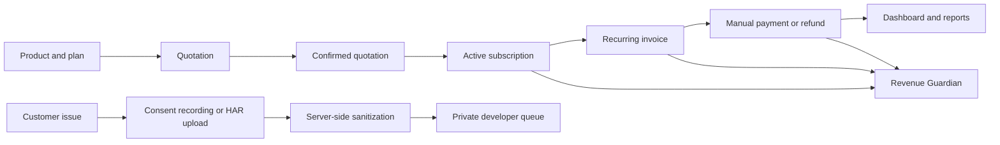

# SubscriptHQ

SubscriptHQ is a role-aware subscription, billing, and revenue-protection platform built with React, FastAPI, SQLAlchemy, Alembic, and PostgreSQL. It brings the complete recurring-revenue workflow into one calm workspace—from products and quotations to invoices, payments, diagnostics, and revenue-risk monitoring.

The project is designed as a functional non-production prototype. It uses real database records and financial calculations rather than hardcoded dashboard data. It does **not** use OpenAI or require an OpenAI API key.

## What makes SubscriptHQ different

### Revenue Guardian

Revenue Guardian is an explainable monitoring layer that continuously looks for revenue leakage and billing integrity problems. Instead of returning a vague warning, every finding contains severity, certainty, evidence, affected record identifiers, a recommended action, detection time, and an operational status.

It checks for:

- Overdue invoices
- Failed payments
- Suspected duplicate payments
- Suspected duplicate invoices
- Incorrect invoice totals
- Paid/due balance mismatches
- Missing subscription-cycle invoices
- Upcoming renewals
- Payment/invoice customer mismatches
- Discounts that remain active after expiry or usage exhaustion

Findings move through **Open → Acknowledged → Resolved**. Guardian scans can be run manually and are also scheduled automatically by the application.

### Privacy-first HAR diagnostics

SubscriptHQ includes a complete customer-to-developer diagnostics workflow with two capture options:

1. **Consent-based semi-automatic recording** records SubscriptHQ API URLs, methods, response statuses, failures, and timings for up to five minutes. A visible indicator follows the user across the workspace. The user can review, discard, or explicitly send the session to developers.
2. **Manual HAR upload** accepts a complete browser-exported `.har` file for difficult issues that require broader network evidence.

Both paths use the same server-side privacy pipeline:

- Authorization values, cookies, API keys, tokens, and sensitive query values are redacted.
- Raw request and response bodies are never stored.
- Customers can access only their own reports.
- Staff and Administrators receive reports in a shared private developer queue.
- Failed and slow requests are highlighted with response codes, timings, hosts, and sanitized URLs.
- A developer-friendly diagnostic report can be downloaded and shared.

These two features turn SubscriptHQ from a billing database into an operational system that actively protects revenue and gives developers useful, privacy-conscious evidence when customers encounter problems.

## Complete feature set

| Area | Working capabilities |
| --- | --- |
| Authentication | Strong passwords, JWT sessions, password-reset tokens, role enforcement, Admin/Staff/Customer portal selection |
| Customer portal | Scoped quotations, subscriptions, invoices, payment history, printable invoices, problem reporting |
| Customer management | Customer records, billing details, currency, activation and archival |
| Product catalog | Product types, sales/cost pricing, notes, variants, attributes, SKUs and price modifiers |
| Subscription plans | Daily, weekly, monthly, quarterly and yearly billing; minimum quantity; availability; payment terms; pause/renew/close rules |
| Quotations | Templates and Draft → Quotation → Confirmed → Active → Closed lifecycle |
| Subscriptions | Automatic creation from activated quotations, quantities, billing periods, renewals and lifecycle controls |
| Invoicing | Recurring invoice generation, idempotent billing keys, taxes, discounts, due dates, printable output and email support |
| Payments | Manual payments, partial payments, idempotency, failure recording and partial/full refunds |
| Dashboard | MRR, ARR, invoiced, collected, outstanding, overdue exposure, trends, renewals and outcome breakdowns |
| Revenue Guardian | Ten explainable billing-risk checks with persistent workflow status |
| HAR diagnostics | Manual upload, consent recording, sanitization, analysis, developer queue and downloadable report |
| Automation | Configurable recurring billing and Guardian scan intervals |

## Role-based experience

The login screen presents three explicit portals and verifies that the selected portal matches the account’s real database role.

- **Administrator:** full business controls, rules, reports, Revenue Guardian and developer diagnostics queue.
- **Staff:** operational customer, quotation, subscription, invoice, payment, reporting and diagnostics access.
- **Customer:** only the customer’s own plans, quotations, subscriptions, invoices and diagnostic submissions.

Public registration always creates a Customer account. Staff creation remains an Administrator-only operation.

## Application flow



## Technology

- Frontend: React 19, Vite 8, responsive CSS
- Backend: FastAPI, Pydantic 2, SQLAlchemy 2
- Database: PostgreSQL / Supabase
- Migrations: Alembic
- Authentication: JWT and bcrypt
- Testing: Pytest and FastAPI TestClient

## Project structure

```text
subscription-system/
├── backend/
│   ├── alembic/              # Database migrations
│   ├── app/
│   │   ├── routers/          # API endpoints
│   │   ├── schemas/          # Request/response contracts
│   │   └── services/         # Billing, Guardian, HAR and reporting logic
│   └── tests/                # Unit, integration and lifecycle tests
├── frontend/
│   └── src/                  # React application and visual system
├── demo-har/                 # Safe synthetic HAR for live demonstrations
├── HAR_LIVE_DEMO.md          # Step-by-step presentation script
└── PROJECT_CONTEXT.md        # Detailed implementation history
```

## Local setup

### 1. Backend

```powershell
cd backend
python -m venv venv
.\venv\Scripts\Activate.ps1
pip install -r requirements.txt
Copy-Item .env.example .env
```

Update `backend/.env` with your PostgreSQL connection and a private JWT secret. Apply the migrations and start the API:

```powershell
alembic upgrade head
uvicorn app.main:app --reload --host 127.0.0.1 --port 8000
```

### 2. Frontend

```powershell
cd frontend
npm install
Copy-Item .env.example .env
npm run dev -- --host 127.0.0.1
```

Open [http://127.0.0.1:5173](http://127.0.0.1:5173).

Do not commit the real `.env`. It is intentionally ignored by Git.

## Email configuration

Password-reset and invoice-email support are implemented. Actual delivery requires private SMTP values in `backend/.env`:

```text
SMTP_HOST=
SMTP_PORT=587
SMTP_USERNAME=
SMTP_PASSWORD=
SMTP_SENDER_EMAIL=
```

The Dashboard readiness panel shows whether email delivery is configured without exposing these values.

## Automation

The local prototype enables lightweight in-app automation by default:

```text
AUTOMATION_ENABLED=true
BILLING_INTERVAL_MINUTES=60
GUARDIAN_INTERVAL_MINUTES=30
```

Recurring billing remains idempotent, so repeated runs do not create duplicate invoices for the same subscription period.

## Verification status

- Frontend lint: passed
- Frontend production build: passed
- HAR diagnostics focused suite: **11/11 passed**
- Commercial lifecycle and Revenue Guardian focused suite: **12/12 passed**
- Backend compilation and OpenAPI generation: passed
- Database migrations `807fd70445a0`, `b31f6c2a9d10`, and `1b0a8fa0a82d`: applied and verified in the configured Supabase database

See [PROJECT_STATUS_REPORT.md](PROJECT_STATUS_REPORT.md) and [SUBSCRIPTHQ_IMPLEMENTATION_REPORT.md](SUBSCRIPTHQ_IMPLEMENTATION_REPORT.md) for the detailed implementation record.

## Live HAR demonstration

Follow [HAR_LIVE_DEMO.md](HAR_LIVE_DEMO.md). The included [`demo-har/subscripthq-demo.har`](demo-har/subscripthq-demo.har) contains only synthetic data and demonstrates successful, failed, slow, and redacted network entries safely.

## Security notes

- Real `.env` files are ignored.
- Private HAR report storage is ignored.
- Virtual environments, dependency folders, generated builds and caches are ignored.
- Financial records are archived rather than destructively deleted where historical integrity matters.
- No OpenAI API or OpenAI API key is used.
